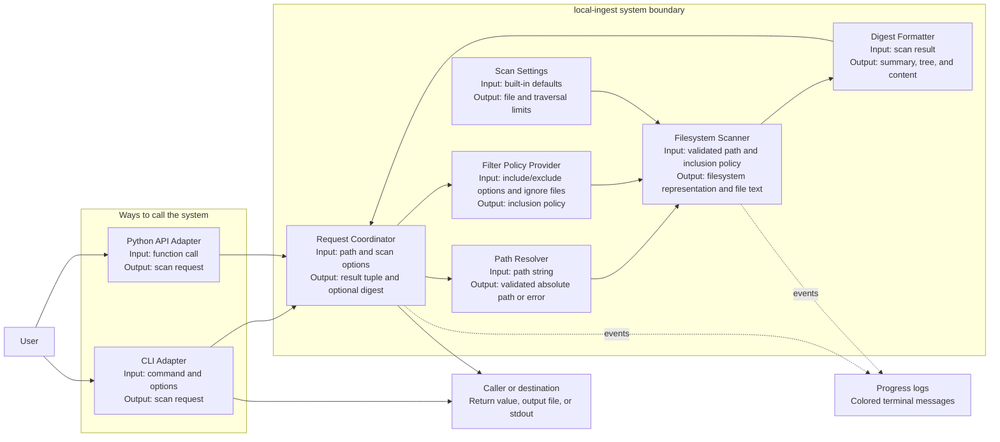

# Black-Box Architecture

This document describes `local-ingest` as a set of black boxes. Each box has a defined responsibility and communicates through inputs and outputs. A reader can understand how the system behaves without depending on its internal implementation.

## System boundary

The system accepts a local path and scan options. It produces a summary, a directory tree, and collected file contents. Depending on the caller, the tree and contents are returned, written to a file, or sent to standard output.

The project does not fetch remote repositories or send scanned data over the network.

## Black-box diagram



The boxes name system responsibilities, not required implementation boundaries. Several source files may implement one box, and a single source file may coordinate more than one step. Their contracts are the important part of this view.

## Box contracts

| Black box | Input | Output | Responsibility | Main implementation files |
| --- | --- | --- | --- | --- |
| CLI Adapter | Shell arguments: source path, filters, size limit, and output option | A scan request; user-facing status and summary | Lets a person run a scan from a terminal | [`src/cli.py`](../src/cli.py) |
| Python API Adapter | A Python function call with a source path and keyword options | `(summary, tree, content)` | Lets another Python program request a scan | [`src/local_ingest.py`](../src/local_ingest.py), [`src/entrypoint.py`](../src/entrypoint.py) |
| Request Coordinator | A scan request | A result tuple; optionally writes tree and content to the requested destination | Connects path validation, policy preparation, scanning, formatting, and output | [`src/entrypoint.py`](../src/entrypoint.py) |
| Path Resolver | A path string | A validated absolute path and query data, or an error | Expands user paths, resolves them, and checks that they exist | [`src/query_parser.py`](../src/query_parser.py), [`src/schemas/ingestion.py`](../src/schemas/ingestion.py) |
| Filter Policy Provider | Include/exclude patterns and ignore files under the source directory | A policy that determines which paths are scanned | Combines built-in exclusions, user filters, and rules from `.gitignore`, `.gitingestignore`, `.ignore`, or any `*.ignore` file | [`src/utils/pattern_utils.py`](../src/utils/pattern_utils.py), [`src/utils/ignore_patterns.py`](../src/utils/ignore_patterns.py), [`src/utils/ingestion_utils.py`](../src/utils/ingestion_utils.py) |
| Filesystem Scanner | Validated path, filter policy, and scan limits | A filesystem representation containing eligible files and metadata | Traverses folders, applies policy and limits, and reads file or notebook text | [`src/ingestion.py`](../src/ingestion.py), [`src/schemas/filesystem.py`](../src/schemas/filesystem.py), [`src/utils/file_utils.py`](../src/utils/file_utils.py), [`src/utils/notebook.py`](../src/utils/notebook.py) |
| Digest Formatter | Filesystem representation and scan metadata | Summary, directory tree, and concatenated content | Converts scan data into text designed to be passed to a language model | [`src/output_formatter.py`](../src/output_formatter.py) |
| Scan Settings | Built-in configuration | File-size, traversal, total-size, and default-output limits | Supplies consistent operational limits to the scan | [`src/config.py`](../src/config.py) |
| Progress Logging | Events from command handling and scanning | Human-readable log messages, colored when supported | Reports progress and diagnostic context without becoming part of the digest | [`src/utils/logging_config.py`](../src/utils/logging_config.py) |

## Observable behavior

### Successful scan

The Python API returns three values:

```python
summary, tree, content = ingest("./project")
```

The CLI displays the summary in the terminal. If an output destination is selected, the destination receives the tree and file contents. With `-o -`, these are written to standard output.

### Invalid source or scan failure

The path resolver or scanner raises an error. The Python API caller receives the exception. The CLI catches the error, prints an error message to standard error, and exits unsuccessfully.

### Asynchronous API

`ingest_async()` provides an asynchronous call signature, but the current filesystem traversal, reads, and formatting are synchronous. Callers should not treat it as a parallel or non-blocking scan.

## Stability principle

The internals of a box can be reorganized as long as its input, output, and responsibility remain compatible. For example, the notebook reader can change implementation without changing the CLI contract or the tuple returned by the Python API.
