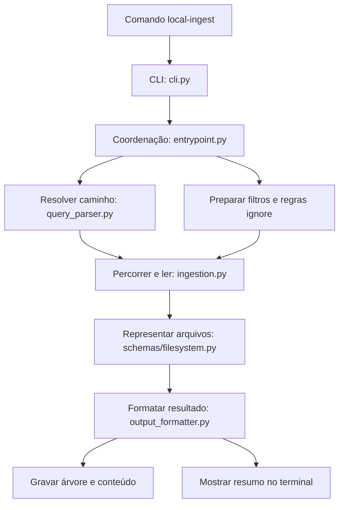

# Fluxo de funcionamento

Este documento descreve como o `local-ingest` transforma um arquivo ou diretório local em um digest de texto e qual é a responsabilidade de cada módulo.

## Visão geral



## Passo a passo

### 1. O usuário inicia o programa

O ponto de entrada instalado pelo `pip` é configurado em `pyproject.toml` como `local-ingest = "cli:main"`. O módulo [cli.py](../src/cli.py) declara as opções, como caminho de origem, filtros, limite de tamanho e destino do resultado.

O CLI normaliza as opções e chama `asyncio.run()` para executar `_async_main()`. Se não for informado outro destino, usa `digest.txt` no diretório atual. Com `-o -`, envia o digest para a saída padrão.

### 2. A entrada coordena a ingestão

O módulo [entrypoint.py](../src/entrypoint.py) fornece as funções `ingest_async()` e `ingest()`.

`ingest_async()` executa estas etapas:

1. Resolve a origem local por meio de `parse_local_dir_path()`.
2. Define filtros de inclusão e exclusão.
3. Lê `.gitignore`, `.gitingestignore` e `.ignore` quando a origem é um diretório e a opção `include_gitignored` está desativada.
4. Chama `ingest_query()` para percorrer os arquivos e produzir o resultado.
5. Se recebeu um destino de saída, grava nele a árvore e o conteúdo.

A função retorna uma tupla com `(resumo, árvore, conteúdo)`. O resumo é apresentado pelo CLI; o arquivo de saída contém a árvore e o conteúdo.

`ingest()` é a interface síncrona da biblioteca. Ela envolve `ingest_async()` com `asyncio.run()`.

### 3. O caminho vira uma configuração

Em [query_parser.py](../src/query_parser.py), `parse_local_dir_path()` expande `~`, resolve o caminho absoluto e confirma que ele existe. Depois, cria um `IngestionQuery`, definido em [schemas/ingestion.py](../src/schemas/ingestion.py).

`IngestionQuery` guarda os dados necessários durante a varredura: caminho, identificador, filtros e limite por arquivo. O projeto opera sobre caminhos locais; não interpreta URLs nem clona repositórios.

### 4. Os filtros são preparados

[utils/pattern_utils.py](../src/utils/pattern_utils.py) normaliza os padrões passados pelo usuário. As regras de exclusão padrão são definidas em [utils/ignore_patterns.py](../src/utils/ignore_patterns.py); o mesmo módulo lê as regras dos arquivos de ignore encontrados na pasta.

[utils/ingestion_utils.py](../src/utils/ingestion_utils.py) testa os caminhos relativos à raiz para decidir se cada arquivo deve ser incluído ou excluído.

### 5. A árvore de arquivos é percorrida

Em [ingestion.py](../src/ingestion.py), `ingest_query()` valida a origem e inicia a leitura. Para diretórios, `_process_node()` percorre os filhos recursivamente e aplica os padrões e limites configurados em [config.py](../src/config.py), incluindo tamanho máximo por arquivo, quantidade máxima de arquivos, profundidade máxima e tamanho total.

Cada item é representado por `FileSystemNode`, definido em [schemas/filesystem.py](../src/schemas/filesystem.py). Os diretórios guardam seus filhos; os arquivos expõem o conteúdo quando o formatador solicita. Links simbólicos são registrados como links, sem seguir o destino.

### 6. O conteúdo é lido e classificado

O modelo `FileSystemNode` usa [utils/file_utils.py](../src/utils/file_utils.py) para ler amostras, detectar binários e tentar decodificar texto. Para arquivos `.ipynb`, usa [utils/notebook.py](../src/utils/notebook.py) para extrair células e saídas do notebook em texto legível.

### 7. O resultado é montado

[output_formatter.py](../src/output_formatter.py) recebe a árvore e constrói:

- um resumo com o caminho, quantidade de arquivos ou informações do arquivo individual e estimativa aproximada de tokens;
- uma árvore de diretórios ordenada;
- o conteúdo de cada arquivo, separado por cabeçalhos.

A estimativa de tokens é aproximada, baseada no tamanho do texto, e não depende de baixar um tokenizer.

### 8. O resultado é apresentado

O `entrypoint` grava árvore e conteúdo no destino escolhido. O CLI mostra o resumo no terminal. Os logs de progresso são configurados em [utils/logging_config.py](../src/utils/logging_config.py); em um terminal compatível, aparecem coloridos.

## Responsabilidade dos módulos

| Arquivo ou pasta                 | Responsabilidade                                                                |
| -------------------------------- | ------------------------------------------------------------------------------- |
| `src/cli.py`                   | Opções do comando `local-ingest` e comunicação com o usuário.            |
| `src/local_ingest.py`          | API pública para uso em Python.                                                |
| `src/entrypoint.py`            | Orquestra a análise e a gravação do digest.                                  |
| `src/query_parser.py`          | Resolve e valida o caminho local recebido.                                      |
| `src/ingestion.py`             | Percorre diretórios, aplica limites e cria a árvore de arquivos.              |
| `src/output_formatter.py`      | Cria resumo, árvore textual e conteúdo final.                                 |
| `src/config.py`                | Define limites e valores padrão.                                               |
| `src/schemas/`                 | Modelos para opções da análise e itens do sistema de arquivos.               |
| `src/utils/pattern_utils.py`   | Normaliza padrões de inclusão e exclusão.                                    |
| `src/utils/ignore_patterns.py` | Define exclusões padrão e lê arquivos de regras ignore.                      |
| `src/utils/ingestion_utils.py` | Verifica correspondência dos caminhos com os filtros.                          |
| `src/utils/file_utils.py`      | Ajuda na leitura e identificação de conteúdo textual ou binário.            |
| `src/utils/notebook.py`        | Converte notebooks Jupyter em texto legível.                                   |
| `src/utils/logging_config.py`  | Configura os logs do programa.                                                  |
| `src/utils/compat_*.py`        | Pequenas adaptações para compatibilidade entre versões do Python e sistemas. |

## Formas de uso

Pela linha de comando:

```bash
local-ingest ./meu-projeto -i '*.py' -i '*.md' -o digest.txt
```

Pela API Python:

```python
from local_ingest import ingest

summary, tree, content = ingest("./meu-projeto", include_patterns={"*.py", "*.md"})
```

## Nota sobre a interface assíncrona

O CLI chama uma função assíncrona, mas a leitura do sistema de arquivos e a montagem do resultado são síncronas. Portanto, a varredura não é paralelizada; `ingest_async()` mantém uma interface compatível com chamadas assíncronas, mas não torna a leitura concorrente.
