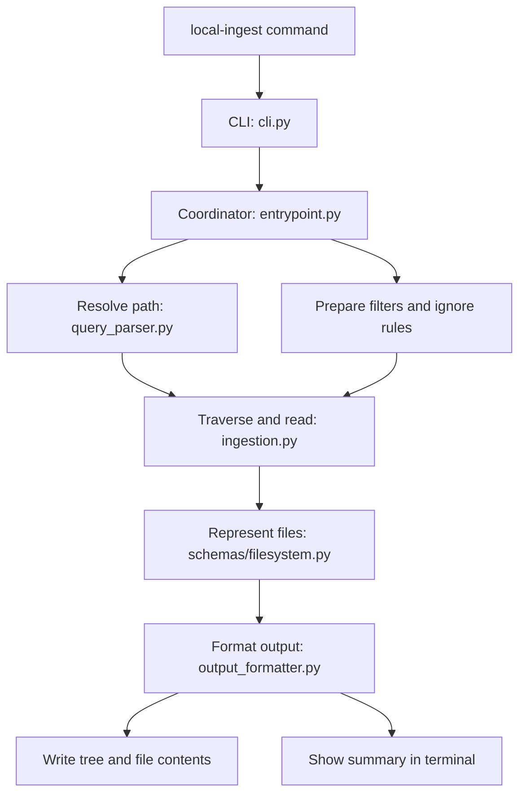

# Workflow

This guide explains how `local-ingest` turns a local file or directory into a text digest and how the main modules work together.

## Overview



## Step-by-step execution

### 1. The user starts the program

The installed command is configured in `pyproject.toml` as `local-ingest = "cli:main"`. [cli.py](../src/cli.py) declares the command-line options, including the source path, filters, maximum file size, and output destination.

The CLI normalizes the options and calls `asyncio.run()` to execute `_async_main()`. Unless a destination is specified, output is written to `digest.txt` in the current directory. Use `-o -` to send the digest to standard output.

### 2. The entry point coordinates ingestion

[entrypoint.py](../src/entrypoint.py) exposes `ingest_async()` and `ingest()`.

`ingest_async()` performs these steps:

1. Resolves the local source path with `parse_local_dir_path()`.
2. Prepares the include and exclude filters.
3. Loads `.gitignore`, `.gitingestignore`, `.ignore`, and other `*.ignore` files found under the source directory when `include_gitignored` is disabled.
4. Calls `ingest_query()` to traverse the source and build the result.
5. Writes the tree and file contents when an output destination is provided.

The function returns `(summary, tree, content)`. The CLI displays the summary; the output file contains the tree and file contents.

`ingest()` is the synchronous library interface. It calls `ingest_async()` through `asyncio.run()`.

### 3. The source path becomes a query

[query_parser.py](../src/query_parser.py) expands `~`, resolves the absolute path, and verifies that it exists. It then creates an `IngestionQuery`, defined in [schemas/ingestion.py](../src/schemas/ingestion.py).

`IngestionQuery` stores the source path, identifier, filters, and per-file size limit needed during a scan. The program operates on local paths; it does not parse URLs or clone repositories.

### 4. Filters are prepared

[utils/pattern_utils.py](../src/utils/pattern_utils.py) normalizes user-provided patterns. Default exclusions are defined in [utils/ignore_patterns.py](../src/utils/ignore_patterns.py), which also reads ignore files under the source directory.

[utils/ingestion_utils.py](../src/utils/ingestion_utils.py) checks paths relative to the source root to decide whether each item should be included or excluded.

### 5. The filesystem is traversed

In [ingestion.py](../src/ingestion.py), `ingest_query()` validates the source and starts the scan. For directories, `_process_node()` recursively visits children and applies filters and limits from [config.py](../src/config.py), including the maximum individual file size, file count, directory depth, and total size.

Each item is represented by a `FileSystemNode`, defined in [schemas/filesystem.py](../src/schemas/filesystem.py). Directory nodes hold their children; file nodes provide their content when requested by the formatter. Symbolic links are recorded without following their targets.

### 6. File contents are read and classified

`FileSystemNode` uses [utils/file_utils.py](../src/utils/file_utils.py) to read samples, detect binary data, and try text encodings. For `.ipynb` files, [utils/notebook.py](../src/utils/notebook.py) extracts cells and notebook outputs as readable text.

### 7. The result is formatted

[output_formatter.py](../src/output_formatter.py) receives the filesystem tree and creates:

- a summary with the path, file count or single-file details, and an approximate token estimate;
- a sorted directory tree;
- the contents of each file, separated by headers.

The token count is approximate and based on text length. It does not download a tokenizer.

### 8. The result is presented

The entry point writes the tree and file contents to the selected destination. The CLI prints the summary in the terminal. Progress logs are configured in [utils/logging_config.py](../src/utils/logging_config.py) and use colors in a compatible terminal.

## Usage examples

Command line:

```bash
local-ingest ./my-project -i '*.py' -i '*.md' -o digest.txt
```

Python API:

```python
from local_ingest import ingest

summary, tree, content = ingest("./my-project", include_patterns={"*.py", "*.md"})
```

## Async API note

The CLI calls an asynchronous function, but filesystem traversal, reading, and formatting are synchronous. Scanning is not parallelized. `ingest_async()` offers an async-compatible interface, but does not make file reads concurrent.
